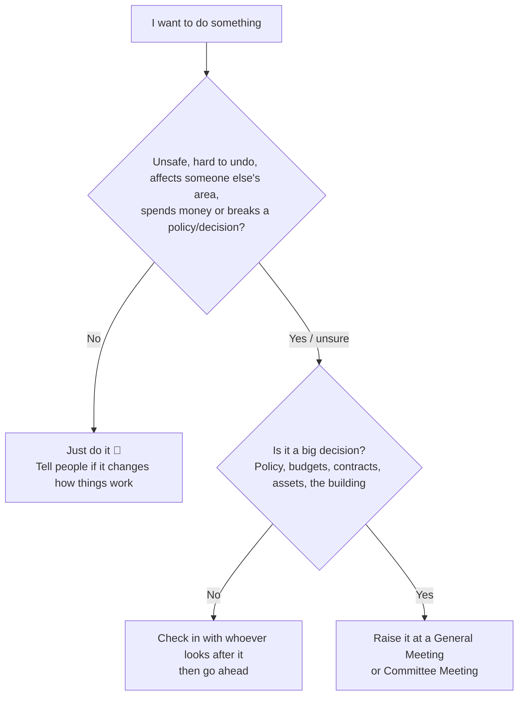

> **Draft – not yet adopted.** This policy is a proposal and needs to be adopted at a general meeting under our [Policy Changes](/policies/policy-changes) process before it applies. Feedback is welcome on the forum.
{.is-warning}

# What is a do-ocracy?
Brisbane Makerspace is run by volunteers, and one of the four pillars of our culture is **just do it**. A do-ocracy is how we put that into practice:

> **If you see something that needs doing, you're empowered to do it. The people who do the work get to make the decisions about that work.**

You don't need permission to make the space better. You don't need to be on the committee, in a Working Group, or a voting member. If the fridge is gross, clean it. If a tool is missing a label, label it. If the wiki is wrong, fix it.

The flip side is that doing something makes you **responsible** for it. A do-ocracy works because people act in good faith, own their results, and check in with others when their actions affect them.

## Principles
1. **Bias towards action.** It's better to do something useful than to wait for someone else to do it, or for a meeting to approve it.
2. **Those who do, decide.** If you're the one doing the work, you get to decide how it's done, within our policies and the limits below.
3. **Don't block doers without good reason.** If someone is doing something you'd do differently, that's not a reason to stop them. Offer to help, or do your own thing alongside it. A good reason to object is safety, a policy breach, real harm to others, or it affects something you're responsible for.
4. **Finish what you start (or hand it off).** Half-done projects are often worse than nothing. If you can't finish, tell people and leave things safe and tidy.
5. **Leave a trail.** Tell people what you did and why, and update the wiki if it changes how something works. The next person will thank you.
6. **Small and reversible beats big and permanent.** The easier something is to undo, the less you need to ask about it first.
7. **Assume good intent.** If someone changed something you didn't expect, talk to them before undoing it.

This policy does **not** override any other policy. Our [Code of Conduct](/bylaws/coc), [Safe Space](/bylaws/safespace), [Safety](/bylaws/safety), [Tool Inductions](/bylaws/inductions), [Storage](/bylaws/storage) and all other policies still apply. "I was just doing it" is never an excuse for breaking one of them.

# The quick test
Before you do something, ask yourself these questions. If the answer to all of them is **no**, just do it.

1. **Could it hurt someone or damage something?**
2. **Would it be hard or expensive to undo?**
3. **Does it affect something that someone else (a person, Working Group or the committee) looks after?**
4. **Does it spend BMS money, or commit BMS to something (a contract, a promise, a public statement)?**
5. **Does it go against a policy, or a decision made at a meeting?**

If you answer **yes** to any of them, check in first (see below for who to check in with). If you're unsure, that's a yes. A quick message costs a lot less than a fix.

# What you can (and should) just do
These are things any member can do without asking first. This list isn't exhaustive. If it's similar to something here and passes the quick test, go for it.

**Cleaning and tidying**
* Clean up a mess, empty bins, wash dishes, sweep the floor, wipe down a bench.
* Put tools and materials back where they belong.
* Clean out the fridge of expired or unlabelled food (in line with our [Community Rules](/policies/communityrules)).

**Small fixes and improvements**
* Label things: tool homes, shelves, drawers, cables, switches.
* Replace basic consumables we already stock (paper towel, glue sticks, sandpaper, bin bags) from our supplies.
* Tighten a loose screw, replace a battery, refill something that's empty.
* Make a sign that helps people (e.g. "please return clamps here"). Keep it friendly and in line with our [Code of Conduct](/bylaws/coc).
* Rearrange *common* areas in small, easily reversible ways, like moving a chair or shuffling things on a general shelf to make space.

**Documentation and digital**
* Fix mistakes, typos and outdated info on the wiki, or write a new how-to guide ([how to make wiki changes](/howto/make-wiki-changes)).
* Answer questions from other members on Discord or the forum.
* Report problems in the right Discord channel (e.g. #infrastructure for wifi or swipe card glitches).

**Community**
* Welcome new people and show them around (within your own inductions and knowledge).
* Help someone with their project, or share your skills.
* Start a casual meetup, a project or a skill-share. If it needs a booking or a regular slot, see [hosting an event](/howto/host-event).
* Propose an idea on the forum, or put something on a general meeting agenda.

**Safety (always)**
* Stop someone using a tool unsafely, or ask them to stop.
* Tag out a broken or unsafe tool and report it, following our [Safety](/bylaws/safety) policy.
* Clear a blocked walkway or exit.

> If something is an **emergency** (a medical, fire or safety incident), don't wait. Act, call emergency services if needed, then follow [time sensitive / emergencies](/howto/find-someone#time-sensitive-emergencies).
{.is-danger}

# Do it, then tell people
Some things are fine to do without asking, but you should let people know afterwards so nobody is surprised:
* Moving something to a new "home" in a shared area: post in Discord and update any signs or wiki pages that mention where it lives.
* Fixing or adjusting a tool in a way that changes how it's used (e.g. replacing a blade, recalibrating): tell the Working Group that looks after it and note it on the tool's wiki page.
* Small purchases of everyday consumables within the limits in [Spending money](#spending-money). Keep the receipt.
* Throwing out something that's clearly rubbish (broken, empty, unlabelled food). If there's *any* chance it belongs to someone, follow the [Storage](/bylaws/storage) policy instead.

# Check in first
If your idea fails the quick test, it might still be a great idea. You just need to check in with the right people first. Checking in isn't asking for a vote. It gives people who are affected, or who look after that area, a chance to raise concerns or help out.

## Who to check in with
Use [How to find the right person to contact](/howto/find-someone) for current names and contact details.

| If it involves... | Check in with |
|---|---|
| A tool, area or resource that a Working Group looks after (repairs, modifications, moving it, changing how it's used, inductions) | That **[Working Group](/bylaws/working-groups)**, via its Facilitator or Discord channel |
| A tool or area with **no** Working Group, or day to day operations (supplies, layout of common areas, onboarding) | The **Head Maker** |
| Spending BMS money, reimbursements, fees or anything financial | The **Treasurer** |
| Network, swipe card / access system, wiki, forum, Discord, email or other digital systems, or anything on the [Restricted Resources](/policies/restricted-resources) list | The **Infrastructure Working Group** (or whoever the list names as manager) |
| Social media, or posting publicly on behalf of BMS | The **Social Media Manager** |
| Another member's project, belongings or stored items | **That member.** If you can't reach them, follow the [Storage](/bylaws/storage) policy |
| Accepting a donation or loan | Someone who can approve it under the [Donations and Loans](/bylaws/donations) policy |
| Running a workshop or event, especially a paid one | The **Head Maker**, and see [hosting an event](/howto/host-event) |
| Talking to the landlord, neighbours, media, sponsors or other organisations on behalf of BMS | The **President** or the **Committee** |
| Anything else you're unsure about | Ask in Discord, or email the **Committee** |

## How to check in
1. **Post it where people will see it.** Use the relevant Discord channel or the forum, and tag the people or group above. Say what you want to do, why, and roughly what it will cost (in money, space and time).
2. **Give people a reasonable chance to respond.** For small things, a couple of days is usually enough. For bigger changes, allow about 7 days.
3. **If nobody objects, go ahead.** Silence after a reasonable check in counts as "go for it". Make a note that you checked in, in case it comes up later.
4. **If someone raises a concern, talk it through.** Most concerns can be fixed by adjusting the plan. A concern isn't a veto, but the person who looks after that area has the final say on it.
5. **If you can't agree,** take it to the Head Maker. If it still isn't sorted, put it on the agenda for the next [general meeting](/bylaws/meetings).

# Bigger decisions (not covered by the do-ocracy)
Some things are too big, permanent or risky for one person to decide. These need a motion at a General Meeting, a Committee Meeting, or a Working Group meeting (where a Working Group has the authority):
* Creating or changing a policy ([Policy Changes](/policies/policy-changes)).
* Creating a new budget, changing one, or spending outside an approved budget.
* Buying a new asset or tool for general use (see [Asset Purchases](/policies/asset-purchases)), or selling, disposing of or permanently removing an existing asset.
* Signing contracts, leases, grant applications or other agreements on behalf of BMS.
* Permanent changes to the building or fixtures (drilling into walls, electrical work, plumbing, structural changes). These may also need approval from our landlord.
* Restricting access to a resource or space, or removing someone's access.
* Anything to do with membership, discipline or [Infractions](/bylaws/infractions).
* Speaking for BMS on a sensitive issue, or anything that could affect our reputation, charity status or insurance.

# Spending money
You're welcome to spend your own money on things for the space. Please remember:
* **Small everyday consumables** (roughly under $50) that we already use and stock can be bought without asking first. Keep an itemised tax invoice or receipt and send it to the Treasurer if you'd like to be reimbursed.
* **Anything larger, or anything that isn't a routine consumable,** needs a check in with the Treasurer (and the relevant Working Group or Head Maker) *before* you buy it if you want to be reimbursed. Reimbursement isn't guaranteed for purchases that weren't checked in.
* **Working Group budgets** are spent under the [Working Groups](/bylaws/working-groups) policy.
* If you don't want to be reimbursed, it's a donation and the [Donations and Loans](/bylaws/donations) policy applies. That includes having someone who can approve it, and making sure tools meet our documentation and induction standards.

# When things go wrong
Mistakes happen, and that's okay. We'd rather people try things and occasionally get it wrong than never do anything at all.
* **If you mess up,** own it, fix it if you can, and tell the people affected. Genuine mistakes made in good faith aren't punished.
* **If someone undoes your work,** talk to them. Don't get into a back-and-forth of redoing and undoing. If you can't sort it out, follow step 5 under [How to check in](#how-to-check-in).
* **If someone repeatedly ignores this policy,** for example by making big changes without checking in, or blocking others without good reason, raise it with the Head Maker or the Committee. Patterns of behaviour may be handled under the [Infractions](/bylaws/infractions) policy.

